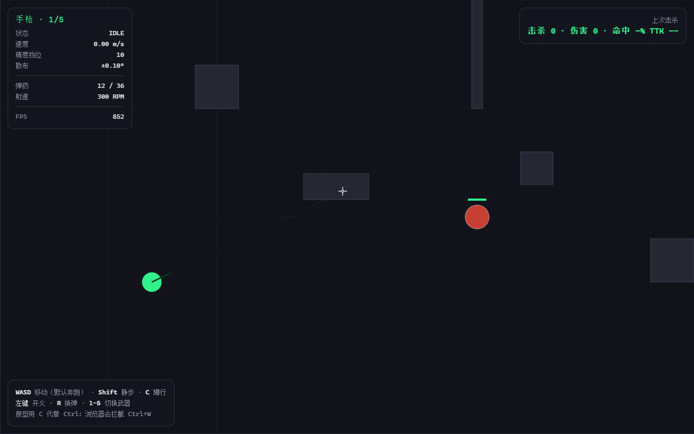

# Bomb Defuse：2D 俯视爆破射击（开发中）

单人开发的 2D 俯视、CS 式回合制爆破射击游戏原型，灵感来自《降维打击》。
目标是做一款「去掉经济门槛、保留枪法与节奏」的轻量爆破射击：双包点地图、短回合、
以移动状态决定精度的枪械系统。

项目**尚未完成**，当前是一个可运行的原型（靶场 + 移动 + 射击手感验证）。



## 当前进度

**已完成**

- **地图**：45 × 35 m 双包点布局，含掩体、连通通道与出生点
- **移动**：奔跑 6.0 / 静步 2.4 / 蹲行 1.2 m/s，带矩形碰撞与加速度插值；
  静步与蹲行不产生脚步声，蹲行降低后坐力并缩小受击判定
- **精度系统**：10 档散布（0.1° ～ 8.0°），按「首发 / 第二发 / 第三发 / 稳态」四段曲线
  随移动状态变化；停火 0.4 s 后自动回挡
- **武器**：手枪 / 精准步枪 / 冲锋枪 / 步枪 / 散弹枪 5 把，含射速、弹匣、备弹、
  换弹时间（散弹枪逐发装填）、距离伤害衰减、爆头倍率
- **射击反馈**：散布锥、弹道曳光、命中飘字、击杀 TTK 与武器统计（击杀 / 伤害 / 命中率）
- **桌面封装**：`main.py` 用 pywebview 把网页原型包成 Windows 窗口，可打包为单文件 exe

**未完成（路线图）**

1. 购买阶段与经济系统（15 s 购买时间、回合奖金、连败补偿、武器/护甲/投掷物）
2. C4 安放 / 拆除、回合胜负判定与比分（BO8，先到 5 分）
3. 敌人 AI 与基础战术行为
4. 联机（服务器权威，放在最后）

## 运行方式

| 方式 | 说明 |
| --- | --- |
| 浏览器（最快） | 直接打开 `prototype/index.html` |
| 桌面版 | `pip install pywebview`，然后 `python main.py` |
| 安装包 | 运行 `BombDefuse-Setup.exe`（打包版，内容可能落后于源码） |

## 操作

| 按键 | 功能 |
| --- | --- |
| W A S D | 移动（默认奔跑） |
| Shift | 静步 |
| C | 蹲行（原型中用 C 代替 Ctrl，避免浏览器拦截 Ctrl+W） |
| 鼠标左键 | 开火 |
| R | 换弹 |
| 1 – 5 | 切换武器 |

## 目录结构

```
main.py                  pywebview 桌面入口 / PyInstaller 打包入口
bomb_defuse_config.json  完整数值配置（回合、移动、精度、武器、经济）
prototype/
  index.html             页面骨架与 HUD
  config.js              原型加载的数值子集（与 json 保持一致）
  game.js                游戏逻辑与 Canvas 渲染
docs/screenshot.png      原型截图
分析游戏玩法.md           对参考游戏《降维打击》的玩法拆解
规划当前任务.md           开发任务记录
BombDefuse-Setup.exe     原型安装包
```

## 数值配置

所有可调数值集中在 `bomb_defuse_config.json`：回合时长（购买 15 s / 战斗 90 s / C4 40 s）、
移动四档速度、10 档精度曲线、5 把武器的伤害与衰减、经济参数等。
`prototype/config.js` 是原型实际读取的子集，改动数值时两处需要同步。

## 说明

代码与美术均为个人开发，仍在快速迭代中，接口和数值都会变。
